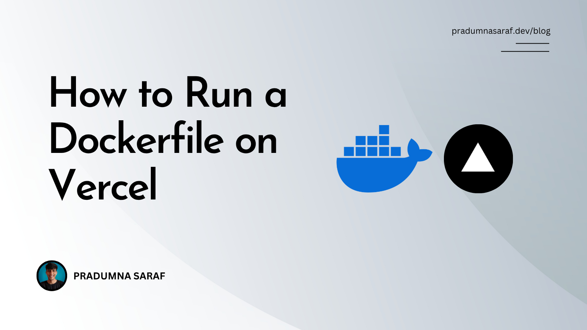

 

Pradumna is an Open Source Developer, Docker Captain, and Microsoft MVP. 

He is passionate about Open Source and has mentored hundreds of people to break into the ecosystem. He also creates content on X (formerly Twitter) and LinkedIn, educating others about Open Source and DevOps tools. Pradumna enjoys engaging with people in person and delivering talks. To learn more about Pradumna, visit [pradumnasaraf.dev](https://pradumnasaraf.dev).

### Latest Blog Post

<a href="https://pradumnasaraf.dev/blog/dockerfile-on-vercel" title="How to Run a Dockerfile on Vercel"><strong>How to Run a Dockerfile on Vercel</strong></a>

<strong>Published on: 10th July 2026</strong>
 Vercel now supports Dockerfile deployments. Learn how to build a simple Golang server and deploy it to Vercel using a Dockerfile...<a href="https://pradumnasaraf.dev/blog/dockerfile-on-vercel">read mode</a> 
  
